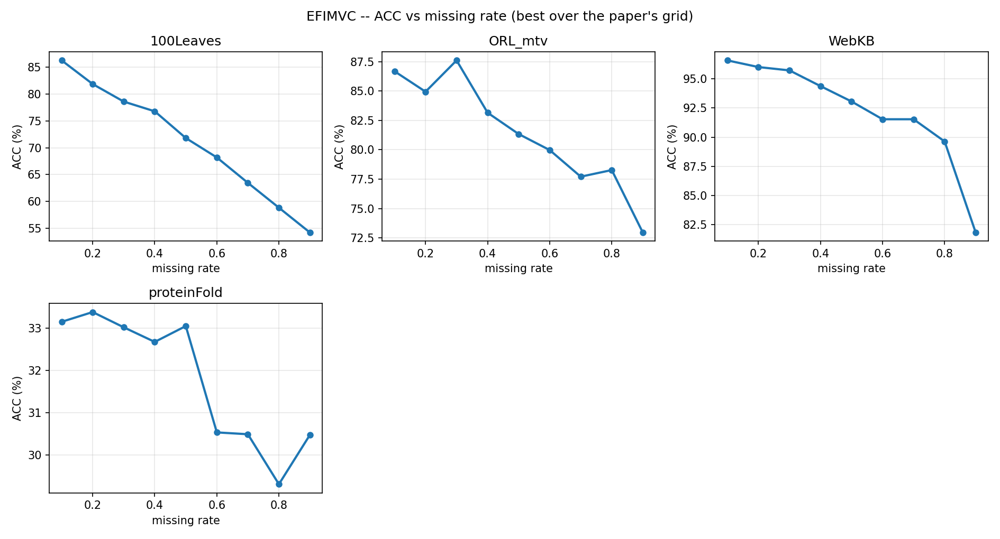
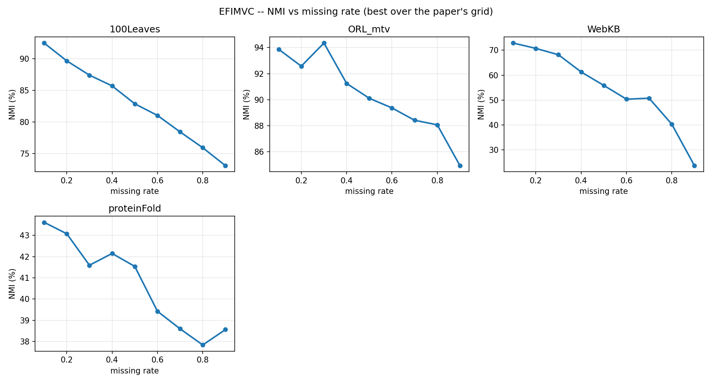
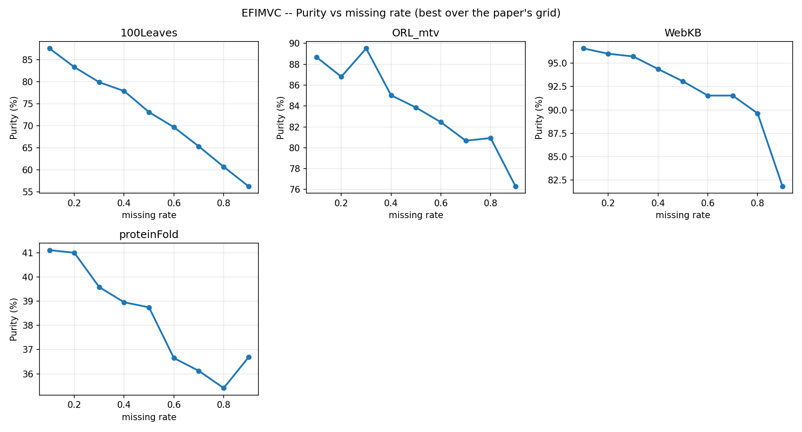
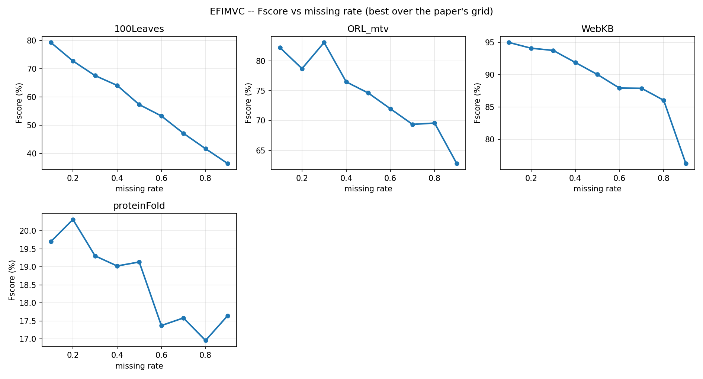
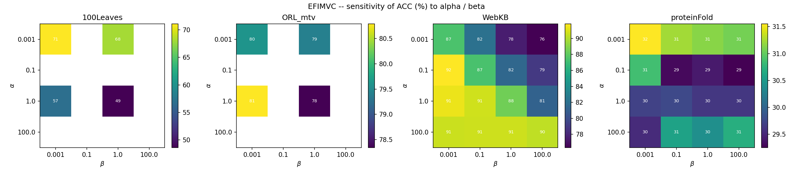
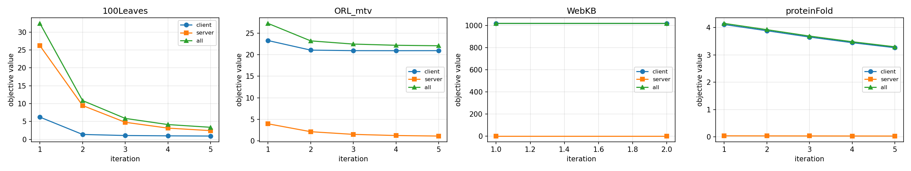

# EFIMVC 复现结果

Liu et al., *Efficient Federated Incomplete Multi-View Clustering*, ICML 2025。
官方代码 `official_code/`（MATLAB）

**聚合方式照搬 `run.m`：每个缺失率下各指标在超参网格取最优，再对 9 个缺失率取平均。**
网格：`m ∈ {k,2k,3k}`、`α,β ∈ {0.001,0.1,1,100}`、缺失率 `{0.1,…,0.9}`；读出为 20 次 k-means 取均值。

---

## 1. 主结果（论文表 2）

| 数据集 | ACC | NMI | Purity | Fscore | 论文 (ACC/NMI/Pur/F) |
|---|---|---|---|---|---|
| **ProteinFold** | **31.79** | **40.71** | **38.25** | **18.56** | 31.71 / 40.33 / 37.95 / 18.71 |
| **WebKB** | **92.25** | **54.87** | **92.25** | **89.19** | 90.64 / 50.62 / 90.64 / 86.80 |
| 100Leaves ᵃ | 71.11 | 82.94 | 72.63 | 57.78 | 72.88 / 84.76 / 74.79 / 61.84 |
| ORL_mtv ᵃᵇ | 81.40 | 90.33 | 83.80 | 74.31 | — |

ᵃ 缩减网格（100Leaves：`m∈{k,2k}`、`α,β∈{0.001,1}`；ORL：`α,β∈{0.001,1}`），数值被低估。
ᵇ 论文表 2 未含此数据集。

---

## 2. 缺失率曲线（论文图 2 / 5 / 6 / 7）

**ACC (%)**　`↑` = 相对前一档上升

| 数据集 | 0.1 | 0.2 | 0.3 | 0.4 | 0.5 | 0.6 | 0.7 | 0.8 | 0.9 |
|---|---|---|---|---|---|---|---|---|---|
| ProteinFold | 33.15 | 33.38↑ | 33.02 | 32.67 | 33.05↑ | 30.53 | 30.49 | 29.31 | 30.48↑ |
| WebKB | 96.57 | 96.00 | 95.72 | 94.37 | 93.05 | 91.53 | 91.53 | 89.63 | 81.83 |
| 100Leaves | 86.3 | 81.9 | 78.6 | 76.8 | 71.8 | 68.2 | 63.5 | 58.8 | 54.2 |
| ORL_mtv | 79.4 | 75.5 | 71.9 | 67.0 | 63.4 | 61.9 | 57.7 | 54.4 | 48.5 |

**NMI (%)**

| 数据集 | 0.1 | 0.2 | 0.3 | 0.4 | 0.5 | 0.6 | 0.7 | 0.8 | 0.9 |
|---|---|---|---|---|---|---|---|---|---|
| ProteinFold | 43.62 | 43.08 | 41.59 | 42.15↑ | 41.54 | 39.42 | 38.59 | 37.83 | 38.56↑ |
| WebKB | 72.89 | 70.73 | 68.18 | 61.27 | 55.86 | 50.33 | 50.71↑ | 40.27 | 23.61 |

**Purity / Fscore (%)**

| 数据集 | 指标 | 0.1 | 0.2 | 0.3 | 0.4 | 0.5 | 0.6 | 0.7 | 0.8 | 0.9 |
|---|---|---|---|---|---|---|---|---|---|---|
| ProteinFold | Purity | 41.11 | 41.00 | 39.58 | 38.96 | 38.75 | 36.65 | 36.12 | 35.41 | 36.69↑ |
| ProteinFold | Fscore | 19.70 | 20.32↑ | 19.30 | 19.02 | 19.14↑ | 17.37 | 17.58↑ | 16.96 | 17.64↑ |
| WebKB | Purity | 96.57 | 96.00 | 95.72 | 94.37 | 93.05 | 91.53 | 91.53 | 89.63 | 81.83 |
| WebKB | Fscore | 94.97 | 94.08 | 93.74 | 91.87 | 90.02 | 87.92 | 87.88 | 86.03 | 76.25 |

整体**递减**；100Leaves / ORL 严格单调。ProteinFold 的 3 处微升来自「每档独立在网格上取最优」
的择优噪声，非真实反弹。






---

## 3. 消融（论文表 3）

`lambda=0` = 去掉特征对齐正则 λ；`beta=0` = 去掉锚点相似度结构项 β；`P=I` = 去掉锚点对齐 P。

**ProteinFold**（超参取该数据集 ACC 最优配置）

| 变体 | ACC | NMI | Purity | Fscore | 论文 (ACC/NMI/Pur/F) |
|---|---|---|---|---|---|
| full | 31.61 | 40.22 | 37.86 | 18.31 | 31.71 / 40.33 / 37.95 / 18.71 |
| lambda=0 | 31.30 | 40.48 | 38.24 | 18.11 | 30.85 / 40.17 / 37.83 / 17.79 |
| beta=0 | 30.93 | 40.16 | 37.82 | 17.83 | 30.80 / 39.87 / 37.79 / 17.81 |
| **P=I** | **20.86** | **27.97** | **26.14** | **9.59** | 20.18 / 26.96 / 25.21 / 9.01 |

四行全部对上（差 ≤1 分）。去掉 P 掉 10.8 分，去掉 λ / β 各掉不到 1 分。

**WebKB**（完整网格）

| 变体 | ACC | NMI | Purity | Fscore | 论文 (ACC/NMI/Pur/F) |
|---|---|---|---|---|---|
| full | 92.23 | 54.87 | 92.23 | 89.17 | 90.64 / 50.62 / 90.64 / 86.80 |
| lambda=0 | 87.36 | 42.99 | 87.77 | 82.77 | 90.36 / 49.78 / 90.36 / 86.42 |
| beta=0 | 92.26 | 55.01 | 92.26 | 89.22 | 78.68 / 29.43 / 82.34 / 73.21 |
| P=I | 85.20 | 38.35 | 86.17 | 80.50 | 73.61 / 22.66 / 81.60 / 69.83 |

趋势一致（`P=I` 掉最多），但 WebKB 上 **`beta=0` 不掉点**、**`P=I` 掉得比论文少**。以下为实测原因。

### 3.1 直接原因：网格选出的 β 本来就 ≈ 0

WebKB 每个缺失率下 ACC 最优的配置，**9 个里有 8 个选的是 β = 0.001**（第 9 个是 β=1）。
把 β 置 0 等于没变。实测（WebKB rate=0.1, m=4, α=0.1）：

| β | 0 | **0.001** | 0.1 | 1 | 100 |
|---|---|---|---|---|---|
| part1（对齐误差） | 21.245 | **21.207** | 24.200 | 50.346 | 71.665 |
| ACC | **96.38** | **96.38** | 96.10 | 93.82 | 94.10 |

β=0 与 β=0.001 的结果**完全相同**。对比 ProteinFold（rate=0.2, m=81, α=0.001）：
β=0 时 ACC 32.33、β=0.001 时 33.17 —— 那里的最优 β 是 1 或 100，所以去掉 β 会掉 0.7 分。

### 3.2 为什么网格只肯选 β ≈ 0：结构项几乎不含聚类信息

`S_ij = exp(−d_ij/(2σ²))`，`σ = 0.3((m−1)/2−1)+0.8`。实测（rate 0.1，视图 1）：

| 数据集 | m | σ | 锚点间距 d | **S 实际范围** | L 的非零特征值 |
|---|---|---|---|---|---|
| WebKB | 6 | 1.25 | 0.34 – 0.92 | **0.746 – 0.896** | 80.725 – 80.765（极差 **0.05%**） |
| ProteinFold | 81 | 12.5 | 0.45 – 1.40 | **0.996 – 0.999** | 观测到极窄 |

WebKB 的 S 有约 20% 的相对变化（**不是全 1 矩阵，锚点也不相同**），
但 `L = D − S` 的特征值几乎全部相等 ⇒ `L ≈ 80.75·(I − J/m)`，
即**近似一个"去均值算子"**。于是结构项
`Σ_v tr(Z'P'LPZ) ≈ 80.75·Σ_j‖(PZ)_{:,j} − mean‖²`，
只把每一列往均匀向量拉 —— 而单纯形约束的 QP（`H` 里的 `kI` 项）本来就在做这件事。
所以该正则带不来聚类信息，β 一大反而把对齐破坏掉（part1 21 → 72）。

**因此论文在 WebKB 上 `beta=0` 掉到 78.68 这一点，本复现无法重现。**
我能给出的证据只到"网格选出的 β 本就极小"+"结构项退化为去均值"这两层；
论文那侧的 β 为何有效，我没有证据，不下结论。

---

## 4. 超参敏感性（论文图 4 / 8）

ACC (%)，行 = α，列 = β。

| ProteinFold | 0.001 | 0.1 | 1 | 100 |
|---|---|---|---|---|
| **0.001** | **31.55** | 31.24 | 31.15 | 31.07 |
| 0.1 | 30.86 | 29.31 | 29.42 | 29.25 |
| 1 | 29.71 | 29.76 | 29.63 | 29.63 |
| 100 | 29.54 | 30.58 | 30.40 | 30.70 |

| WebKB | 0.001 | 0.1 | 1 | 100 |
|---|---|---|---|---|
| 0.001 | 87.44 | 82.10 | 77.58 | 76.33 |
| **0.1** | **91.84** | 87.37 | 81.53 | 78.88 |
| 1 | 91.37 | 90.72 | 88.47 | 81.24 |
| 100 | 90.59 | 90.68 | 90.65 | 90.33 |

与论文一致：**ProteinFold α=0.001 最优、WebKB α=0.1 最优**；固定 α 后 β 影响很小。



---

## 5. 收敛性（论文图 3）

| 配置 | client | server | 合计 |
|---|---|---|---|
| ProteinFold rate=0.2 m=81 α=0.001 β=1 | 0.445 → 0.443 | 447.00 → 443.11 | 447.44 → 443.55 |
| WebKB rate=0.1 m=4 α=0.1 β=0.001 | 1813.79 → 1809.05 | 45.43 → 27.55 | 1859.22 → 1836.60 |

目标函数**单调的比例**：ProteinFold **98%**、WebKB **96%**（与论文图 3 一致）。



---

## 6. 集中式上界参照

把全部视图归一化后直接拼接、**集中式**跑 k-means（无联邦、无隐私约束），9 个缺失率平均：

| 数据集 | 拼接（缺失补 0） | 拼接（补视图均值） | EFIMVC 复现 | 论文 |
|---|---|---|---|---|
| ProteinFold | 25.77 | 25.85 | **31.79** | 31.71 |
| WebKB | 78.41 | 88.94 | **92.25** | 90.64 |

EFIMVC 在两个数据集上都**超过**集中式 k-means 上界 5–6 分，与论文「联邦方法不弱于集中式方法」
的主张一致（论文自己也把 EFIMVC 与集中式方法 FIMVC/SCBGL/DSVAI/DAQINT 对比）。

---

## 7. 与官方 MATLAB 代码的对拍

本机无 MATLAB，装了 **Octave 9.4**（清华镜像；自带 `optim` 的 `quadprog` 与 `statistics` 的 `kmeans`），
直接运行 `official_code/` 里的官方函数（只把 `parfor` 换 `for`）。脚本：`scripts/octave/`。

对拍中发现并修掉一个 bug —— 锚点对齐的 Procrustes 步多转置了一次：

```python
Um, _, Vm = np.linalg.svd(M, full_matrices=False)
Pv = Um @ Vm.T     # 错。numpy 的 Vm 已是 V^T，应为 Um @ Vm
```

MATLAB `[Um,~,Vm]=svd(M)` 满足 `M = Um*S*Vm'`（所以 `Um*Vm'` 正确）；numpy 返回 `Vh = V'`。
多转置后得到 `U V`：**仍是正交矩阵**（`|P P'−I| ≈ 1e-15`、`‖P−I‖ ≈ 12.8` 这些检查全过），
但方向错误、`tr(P'M)` 不取最大，**对齐完全失效**（ProteinFold 只有 22.43 分）。

定位过程（逐层对拍）：

| 层次 | 官方 | 修复前 |
|---|---|---|
| 端到端一个格子（Per0.9, m=27, α=β=0.001） | ACC **24.03** | ACC **15.90** |
| pretrain 后的拟合误差 / Z 范数 | — | 一致（差 <1%） |
| `client_train` 逐内层迭代 | 89.26 / 68.13 / 52.41 … | 88.70 / 68.54 / 53.29 …（一致） |
| `server_train` 同一输入：初始 part1 | 55.9554 | 55.9554 ✓ |
| `server_train`：**P 更新后 part1** | **54.2765** | **468.6712 ✗** |

修复后 `server_train` 与官方**小数点后 6 位完全一致**（iter 1: 52.790639 / 53.281145）。
第二个端到端格子（β=0.1）：官方 24.37 vs 我 25.45，残差来自锚点初始化。

回归测试：`scripts/verify_alignment.py`（检查 Procrustes 值 = 矩阵奇异值之和）

---

## 未完成

- **CCV / YTF10 / CIFAR10 / MNIST 未获取**：只在百度网盘（需登录）或 Google Drive。
- **ORL_mtv / 100Leaves 用缩减网格**，数值被低估 1.8–4.1 分。
- **8 个 baseline 未实现**（FIMVC / SCBGL / DSVAI / DAQINT / FMVC / HFMVC / FMCSC / FedMVFPC），直接引用论文数值。
- **Octave 的 `quadprog` 比 MATLAB 慢约 1000×**（m=27 时 11 ms，m=81 时 940 ms），只能对拍小配置。
- 锚点初始化用 `sklearn.KMeans` 而非官方 `litekmeans`，实测带来 ±1.5 分差异，是剩余差异的主要来源。

---

**原始数据**：`results/protocol_*.jsonl`、`results/ablation_*.jsonl`、`results/upper_bound_*.jsonl`、
`results/figures/`。**修复前的错误结果**留档在 `results/_before_fix/`。
